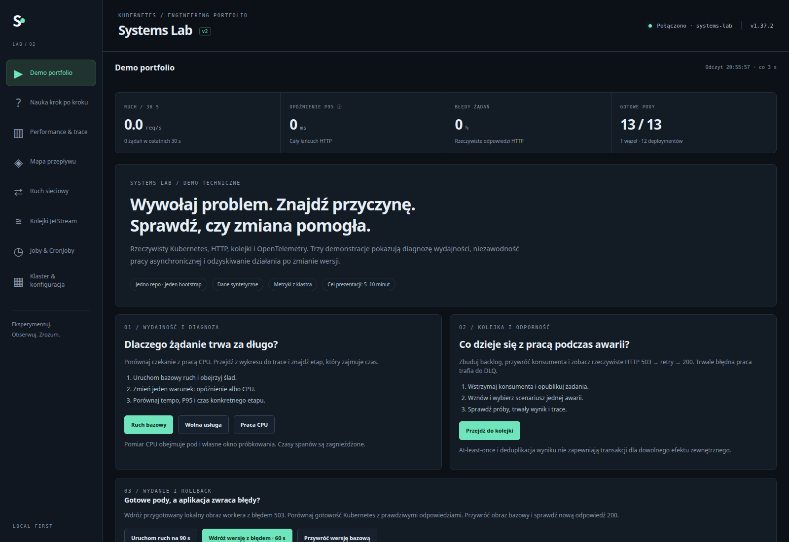
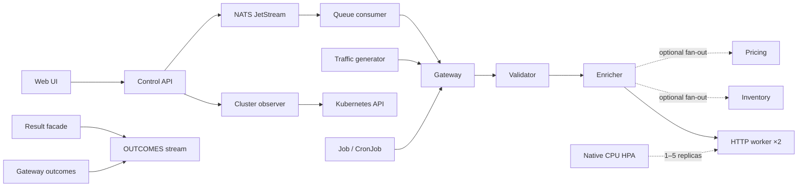

# Systems Lab

A local Kubernetes portfolio demonstrator for designing, observing and diagnosing
distributed systems. [Accepted goal and roadmap](docs/roadmap.md).

An interactive Kubernetes playground. Generate real HTTP traffic, inspect
live cluster resources, scale services, replace pods, build a queue backlog and
watch Kubernetes Jobs run. Everything needed to create and configure the lab
lives in this repository.

[](docs/assets/systems-lab-demo.mp4)

[Watch the 53-second walkthrough](docs/assets/systems-lab-demo.mp4) ·
[Interview demo script](docs/portfolio-demo.md) ·
[Architecture decisions](docs/decisions/0001-local-portfolio-boundary.md)

## Pierwsze uruchomienie i nauka

Po `make up` otwórz **http://127.0.0.1:18085**. Domyślny widok **Demo portfolio**
prowadzi przez trzy demonstracje: wydajność, niezawodną kolejkę i zmianę wersji
z rollbackiem. [Scenariusz prezentacji](docs/portfolio-demo.md).

Do poznania pojęć wybierz **Nauka krok po kroku**.
Dziewięć polskich lekcji wyjaśnia cel, akcję, oczekiwany wynik i przyczynę zjawiska.
Zaliczenie wymaga prawdziwych danych z klastra. Słownik tłumaczy Pod, Service,
Deployment, trace/span, P95, ACK i DLQ.

W **Performance & trace** zobaczysz wykresy CPU/RAM z Kubernetes Metrics API,
ruch i opóźnienia, czasy funkcji/etapów, czasy zadań oraz waterfall OpenTelemetry.
Jaeger jest dostępny pod `/tracing/` przez ten sam lokalny panel. Dane nie wymagają
monitorowania systemu hosta. [Polski przewodnik](docs/learning-observability.md).

## Experiments, resilience and automatic response

**Eksperymenty A/B** measures a scoped baseline and one intervention: propagated
run IDs, configuration snapshots, actual throughput/latency/payload, traces,
action timeline and downloadable JSON. Complete CPU/RAM windows are required;
missing measurements stay missing. [Experiment contract](docs/experiments.md).

**Odporność systemu** demonstrates timeout/504, admission/429, circuit breaker
suppression/recovery and real parallel inventory/pricing calls. Outcomes have
independent bounded broker retention. [Limits and guarantees](docs/resilience.md).

The same view demonstrates native CPU **HPA**: provoke load on one worker, enable
1–5 replicas, inspect the actual scaling reason, ready pods and measured effect.
Reset restores the lab. Queue-driven autoscaling remains optional future work.
[HPA workflow](docs/autoscaling.md).

## Start

Prerequisites: **Linux amd64**, a running Docker daemon accessible to your user,
Python 3, curl, and about **4 CPU / 6 GiB RAM / 12 GiB free disk**. The first start
downloads the pinned Minikube/Kubernetes tools and container images. No cloud
account, registry credentials, npm, Helm, or host Go installation is required.

```sh
git clone https://github.com/maciekb2/task-manager2.git
cd task-manager2
make up
```

Open **http://127.0.0.1:18085**. `make up` creates the dedicated `systems-lab`
Minikube profile, builds the application image, loads it into the node, installs
RBAC/storage/services/workloads, waits for readiness, and opens a loopback-only
port-forward. Its kubeconfig is in `.state/`; your current kubectl context is not
changed. Defaults: Minikube 1.39.0, Kubernetes 1.37.2, 4 CPU, 6144 MiB RAM.

```sh
make status                   # Cluster and workloads
make deploy                   # Rebuild changed source and reconcile this lab
make open                     # Reopen the panel after a port-forward ends
make stop                     # Stop the profile, preserving local data
make up                       # Resume and reconcile it
LAB_PORT=18086 make open       # Use another local port
LAB_CPUS=6 LAB_MEMORY=8192 make up
```

The HTTP generator starts **stopped** and the CronJob starts **suspended**. Traffic
has a maximum duration of 300 seconds and concurrency/rate limits. For the normal
demo, select **Normalny ruch** in the panel.

## What is running?

Fourteen separately deployed components: twelve application roles sharing one
small Go image, plus NATS and Jaeger. Separate deployments demonstrate runtime
behavior; their number is not a claim of independent product/domain boundaries:



* **Web** serves the interface and proxies the API.
* **Control** configures experiments and performs bounded namespace actions.
* **Observer** discovers nodes, deployments, pods, services, metrics, jobs and events.
* **Generator** makes HTTP requests with a real concurrency and time budget.
* **Gateway** receives traffic and propagates a correlation identifier.
* **Validator** checks `units` (1–10) and rejects invalid work with HTTP 422.
* **Enricher** adds a workload class and request identifier.
* **Echo** performs configurable delay/CPU work and returns a controlled HTTP outcome.
* **Result store** consumes gateway outcomes and persists them in JetStream KV.
* **Consumer** processes queued work, persists state, retries and routes to DLQ.
* **Jaeger** receives standard OTLP spans and serves native trace search/waterfalls.
* **NATS** stores events, task messages, outcomes and the dead-letter stream on a PVC.

The topology contains resources actually discovered from Kubernetes. Dashed links
come from dependency annotations on the deployed workloads. Animated links/counts
come from actual events. Animation marks activity in the last five seconds;
counters cover the available events in the last 30 seconds. Selecting an event shows correlated
hops, status codes, durations and pod identities. The event list is complemented by standard OpenTelemetry SDK spans propagated with
W3C trace context and exported via OTLP/HTTP to Jaeger. The graph is not packet-level
network discovery.

## See application data moving

Open **Ruch sieciowy** for HTTP response-body and JetStream message-payload
transfer rates, measured per hop. It shows KiB/s and Mbit/s, completions per
second, mean payload size and mean interval between observed completions.
Counters use closed five-second buckets and a 30-second average, independently
of the limited recent-event display. History covers up to five minutes since
controller startup. The interface refreshes this report every five seconds.

Set **Dodatkowe dane odpowiedzi** to +8 KiB and compare 5 with 20 requests/s.
At 20 requests/s the nominal request interval is 50 ms; the added payload alone
would be 160 KiB/s per hop. Actual values include the JSON body and depend on
concurrency, latency and successful completion. A response traverses four HTTP
hops, so summing them counts those bytes four times. This is application payload
throughput, not an interface capacity test or a TCP packet capture.

The map's **Na połączeniach → Transfer danych aplikacji** mode labels each
observed hop with its 30-second average. HTTP arrows reverse to show response
data returning to the client. JetStream arrows follow publish/delivery direction;
redelivery counts again, while ACK/NAK is excluded. Headers, TCP/IP, TLS, CNI,
NATS KV, observability and Kubernetes API traffic are outside this measurement.
No host agent or privileged packet sniffer is installed.

Run `python3 scripts/network-smoke.py` for focused byte-accounting, payload-size,
retry and stopped-traffic acceptance against the local lab (`LAB_URL` overrides
the URL). It restores stopped traffic and the baseline response configuration.

## Try the experiments

1. **HTTP:** start normal traffic; select a service and inspect its pods/logs.
2. **Latency:** select the slow-service scenario. Change concurrency and compare
   throughput and p95 (the latest 30 seconds).
3. **Errors:** select controlled HTTP failures. The response propagates through the
   real service chain. Reset returns to successful responses.
4. **Scaling:** select HTTP worker and set 3 replicas. Watch readiness and pod names.
5. **Self-healing:** choose a demo pod and click **Odtwórz pod**. Kubernetes replaces it.
6. **Queues:** stop the consumer, enqueue work, observe pending messages, then resume.
   Select one/two failures to demonstrate retry or permanent failure for DLQ.
7. **Jobs:** create a successful Job or a failing Job. Kubernetes retries the process.
8. **Cron:** enable a one-minute schedule, observe an actual scheduled Job, then pause.

Reset stops traffic, restores the demo replica counts and suspends the CronJob. It
does **not** erase task/event history or stop in-flight work instantly.

The **Demo portfolio** view starts with the engineering walkthrough; **Nauka**
offers a simplified guided experience. **Mapa przepływu**
can show just the HTTP path or the full infrastructure. **Performance & trace**
has component/time filters, function timings, pod resource samples and native spans.
CPU/RAM samples are not precise per-request CPU accounting. Chart history is 15
minutes in control memory; Jaeger retains up to 5000 traces in memory.

## Verify and develop

```sh
make test                     # Go unit/race checks; downloads Go 1.26 if needed
python3 scripts/release-smoke.py       # Real image update, HTTP failure and rollback
python3 scripts/observability-smoke.py  # Focused OTel, resource history and queue timings
make smoke                    # Real-cluster HTTP, scale, pod recovery, retry/DLQ,
                              # Job, failed Job and one real CronJob run (~3–5 min)
```

The smoke test mutates only this lab and restores baseline settings on exit. Local
evidence is written to `.state/smoke-results.json`. `make test` requires host Go with
automatic toolchain downloads enabled; `make up` builds with Go inside Docker.
See [architecture](docs/architecture.md) and [migration](docs/migration.md).

## Boundaries and data

This is a single-user local teaching environment, not a multi-tenant service.
Only the web panel is forwarded, on loopback. The API requires a same-origin
session token for mutations, validates parameter limits and has no arbitrary URL,
shell, manifest, namespace or image execution endpoint. The observer cannot read
Secrets; the controller has no rights in other namespaces. The controller's pod
deletion privilege covers the lab namespace; the application additionally limits
which demo pods may be replaced. Do not expose the panel using a public ingress.

NATS credentials are randomly generated during bootstrap and stored in a native
Kubernetes Secret, never committed. `.state/` contains cluster credentials and
local evidence and must remain private. NATS is intentionally single-node; its PVC
survives normal restarts, but is **not an offsite backup**. Events/HTTP outcomes have
1-hour retention, task results/DLQ 24 hours, with explicit size limits. Job history
is temporary. Use synthetic data only.

To deliberately destroy this lab and its stored messages/results:

```sh
LAB_CONFIRM_DELETE=systems-lab make down
```

Other Minikube profiles, Docker workloads and remote clusters are not targets.

## History

This continues the Task Manager experiments in one repository. The original code
from this repository remains in [`legacy/v1`](legacy/v1). The separate
[`task-manager`](https://github.com/maciekb2/task-manager) history is preserved;
archiving that predecessor follows acceptance of this replacement, not bootstrap.

## Automated acceptance

[Systems Lab CI](https://github.com/maciekb2/task-manager2/actions/workflows/systems-lab.yml)
uses an ephemeral Ubuntu hosted runner, native make/Python checks and a fresh local
Minikube. It runs on pull requests and pushes to main, without private credentials
or a self-hosted runner. Receipts go to the job summary; kubeconfigs/secrets are not
uploaded. A CI lab run is separate from a production delivery pipeline.
